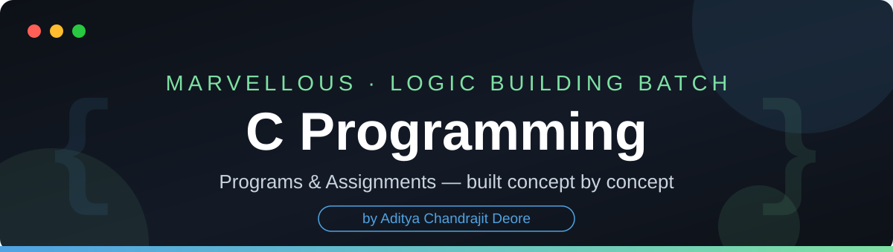

<div align="center">



<br/>


<br/>

**Every program in this repository was compiled with GCC and tested against the sample cases from its assignment sheet before being committed.**

</div>

---

## 📖 About

This repository contains my complete **C programming** work for the **Marvellous Logic Building Batch** — the foundation course where every concept is built in order: data types and operators first, then decision making, iteration, functions, and problem solving on top of them.

Each assignment contains **5 programs**. Every program is written as a small helper function (the *service provider*) plus an entry-point `main()` that accepts input, calls the helper, and displays the result — the exact structure used in the batch.

<div align="center">

| 📚 Assignments | 💻 Programs | 🧪 Tested | 📈 Status |
|:---:|:---:|:---:|:---:|
| 6 | 30 | Every program, against its PDF sample cases | ✅ Complete |

</div>

---

## 🗂️ Assignment Index

### Assignment 1 — First Steps

| # | Program | What it does |
|:---:|---|---|
| 1 | [program1_1.c](Assignments/Assignment_1/program1_1.c) | Divide two numbers |
| 2 | [program1_2.c](Assignments/Assignment_1/program1_2.c) | Print **“Marvellous”** five times on screen |
| 3 | [program1_3.c](Assignments/Assignment_1/program1_3.c) | Print numbers from **5 to 1** on screen |
| 4 | [program1_4.c](Assignments/Assignment_1/program1_4.c) | Accept one number and check whether it is **divisible by 5** or not |
| 5 | [program1_5.c](Assignments/Assignment_1/program1_5.c) | Accept one number and print that number of `*` on screen |

### Assignment 2 — Iteration & the Updater Concept

| # | Program | What it does |
|:---:|---|---|
| 1 | [program2_1.c](Assignments/Assignment_2/program2_1.c) | Print `*` a given number of times — `while` loop with a counter |
| 2 | [program2_2.c](Assignments/Assignment_2/program2_2.c) | Print `*` a given number of times — `while` loop with the updater on the input itself |
| 3 | [program2_3.c](Assignments/Assignment_2/program2_3.c) | Print **“Hello”** if the number is less than 10, otherwise print **“Demo”** |
| 4 | [program2_4.c](Assignments/Assignment_2/program2_4.c) | Display the first number for the given frequency — e.g. `12, 5 → 12 12 12 12 12` |
| 5 | [program2_5.c](Assignments/Assignment_2/program2_5.c) | Check whether a number is **even or odd** (`ChkEven`) |

### Assignment 3 — Factors, Characters & Vowels

| # | Program | What it does |
|:---:|---|---|
| 1 | [program3_1.c](Assignments/Assignment_3/program3_1.c) | Print the first **N even numbers** — `7 → 2 4 6 8 10 12 14` |
| 2 | [program3_2.c](Assignments/Assignment_3/program3_2.c) | Display the **factors** of a number (`DisplayFactor`) |
| 3 | [program3_3.c](Assignments/Assignment_3/program3_3.c) | Display the **even factors** of a number (`DisplayEvenFactor`) |
| 4 | [program3_4.c](Assignments/Assignment_3/program3_4.c) | Accept one character and **convert its case** — `a → A`, `D → d` |
| 5 | [program3_5.c](Assignments/Assignment_3/program3_5.c) | Check whether a character is a **vowel** (`ChkVowel`) |

### Assignment 4 — Decision Making

| # | Program | What it does |
|:---:|---|---|
| 1 | [program4_1.c](Assignments/Assignment_4/program4_1.c) | Check whether a number is **positive, negative or zero** |
| 2 | [program4_2.c](Assignments/Assignment_4/program4_2.c) | Check whether a number is **even or odd** |
| 3 | [program4_3.c](Assignments/Assignment_4/program4_3.c) | Find the **greater of two numbers** — or report them equal |
| 4 | [program4_4.c](Assignments/Assignment_4/program4_4.c) | Check **voting eligibility** — 18+, with a negative age treated as invalid |
| 5 | [program4_5.c](Assignments/Assignment_4/program4_5.c) | Check **divisibility by 5** |

### Assignment 5 — Working with Three Values & Rules

| # | Program | What it does |
|:---:|---|---|
| 1 | [program5_1.c](Assignments/Assignment_5/program5_1.c) | Find the **greatest of three numbers** — correct even when values are equal |
| 2 | [program5_2.c](Assignments/Assignment_5/program5_2.c) | Check a **leap year** by Gregorian rules — divisible by 400, or by 4 but not by 100 |
| 3 | [program5_3.c](Assignments/Assignment_5/program5_3.c) | Calculate a **student's grade** — A / B / C / D / Fail, with marks outside 0–100 invalid |
| 4 | [program5_4.c](Assignments/Assignment_5/program5_4.c) | Check divisibility by **both 3 and 5**, only 3, only 5, or neither |
| 5 | [program5_5.c](Assignments/Assignment_5/program5_5.c) | Identify a **character type** — uppercase, lowercase, digit or special — using comparisons only |

### Assignment 6 — Real-World Calculations

| # | Program | What it does |
|:---:|---|---|
| 1 | [program6_1.c](Assignments/Assignment_6/program6_1.c) | Calculate an **electricity bill** with slab rates — first 100 units ₹5, next 100 ₹7, above 200 ₹10 |
| 2 | [program6_2.c](Assignments/Assignment_6/program6_2.c) | Check **admission eligibility** — marks ≥ 60 **and** age ≥ 17 |
| 3 | [program6_3.c](Assignments/Assignment_6/program6_3.c) | Calculate a **shopping discount** — 0% below ₹1000, 10% up to ₹5000, 20% above |
| 4 | [program6_4.c](Assignments/Assignment_6/program6_4.c) | Check **triangle validity** — all sides positive, and any two sides sum to more than the third |
| 5 | [program6_5.c](Assignments/Assignment_6/program6_5.c) | Calculate an **employee bonus** by years of service — 15% / 10% / 5% of salary |

---

## 🌳 Repository Structure

```text
C_Programming/
│
├── README.md
├── LICENSE
├── .gitignore
├── assets/                 ← banner & footer artwork used in this README
│
├── Assignments/
│   ├── Assignment_1/       ← program1_1.c … program1_5.c
│   ├── Assignment_2/       ← program2_1.c … program2_5.c
│   ├── Assignment_3/       ← program3_1.c … program3_5.c
│   ├── Assignment_4/       ← program4_1.c … program4_5.c
│   ├── Assignment_5/       ← program5_1.c … program5_5.c
│   └── Assignment_6/       ← program6_1.c … program6_5.c
│
└── Classwork/
    └── Day_NN/             ← classwork, added as the batch progresses
```

---

## ▶️ How to Compile & Run

Every program is a single self-contained `.c` file — no extra setup.

```bash
# Compile
gcc program1_1.c -o program1_1

# Run
./program1_1
```

**Example — Assignment 6, Program 1 (electricity bill):**

```text
Enter consumed units: 150
Bill = 850.00
```

---

## 👨‍💻 Author

<div align="center">

**Aditya Chandrajit Deore**
B.Tech Information Technology — PCCOE, Pune

[](https://github.com/AdityaxDeore)
[](https://www.linkedin.com/in/aditya-deore-3a725a263/)
[](https://adityadeore.vercel.app)
[](https://x.com/AdityaDeore2678)


</div>
